# ARKANA: 4 patronlu zor hikaye (v27, 2026-10-13)

Önceki sürüm (v26) `arkana-v26.html`, kaynak `arkana10.html`.

- Hikaye 40 seviye, 4 patron: İskelet Kral (10), Kemik Ejderha (20), Dev Zombi (30), VORTEKS (40). 30'dan sonraki çizgi roman VORTEKS'in hikayesini anlatıp finale bağlanıyor.
- Hikaye daha zor: düşmanlar seviyeyle daha çok can kazanıyor, daha sert ve daha sık vuruyor. Test: sabit duran bot 8. seviyede öldü; oynayan iki bottan biri VORTEKS'te öldü, biri finali gördü.
- Kasma: ekrandaki düşman sayısı telefonda en fazla 170 (önceden 420), aynı anda en fazla 12 ses (büyük kavgalarda yüzlerce ses açılıyordu), patlama sesleri her seferinde yeniden üretilmiyor, efekt parçacıkları ve hasar sayıları azaltıldı, "EFSANE x..." yazısı sadece büyük kombolarda.
- Üst bilgi tek satır: güç çubuğu solda, süre · Sv 12/40 · 👑20 · ölüm · skor yanında. "renk" kutusu kaldırıldı.

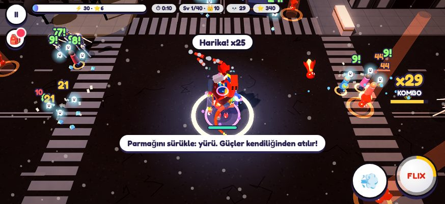
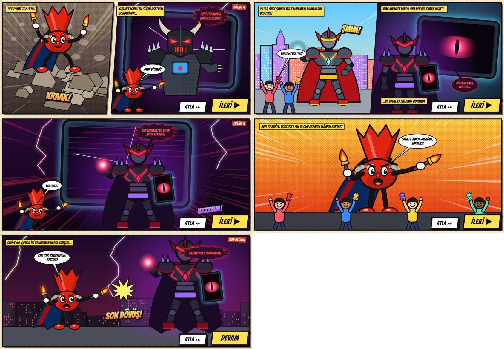

---

# ARKANA: Akıcı oyun ve küçük üst bilgi (v26, 2026-10-13)

Önceki sürüm (v25) `arkana-v25.html`, kaynak `arkana10.html`.

- Seviye/dalga, süre ve skor kutuları daha yukarıda ve daha küçük; XP çubuğu inceldi.
- Kasma düzeltmeleri: patron ve tüm silah görünümleri oyunun başında bir kez hazırlanıyor (önceden ilk patron ve her yeni silah bir an donduruyordu). 120 Hz iPhone/iPad'de Ultra dahil her ayar 60 fps çiziyor (ısınma ve sonradan yavaşlama azalır). Ultra telefonda/tablette en fazla ~3,2 milyon piksel. Efekt katmanı daha az bellek harcıyor, parçacık ve hasar sayıları sınırlı, üst bilgi sadece değiştiğinde yenileniyor.
- Test: tüm menüler ve modlar hatasız; bot hikayeyi yine baştan sona bitirdi.

---

# ARKANA: Hikaye Bölümleri, Görünür Silahlar, Kademeler (v25, 2026-10-13)

Önceki sürüm (v24) `arkana-v24.html`, kaynak `arkana10.html`.

- Hikaye modu: 50 seviye, 5 bölüm. Her seviye 20 saniye, üstte "Seviye N/50 · Patron 10". Her 10. seviyede patron sırayla gelir (İskelet Kral, Kemik Ejderha, Mezar Devi, Kıyamet Lordu, VORTEKS), patron savaşında düşmanlar da gelir. Başta giriş çizgi romanı, her patrondan sonra bölüm sonu ve sonraki bölümün çizgi romanı, VORTEKS'ten sonra final ve mod biter. Menüdeki "Hikayeyi oku" kaldırıldı.
- Silahlar 24'e çıktı: 🗡️ Flix Kılıcı, 🚀 Omuz Roketi, 🔫 Flix Makinesi, 🔨 Dev Çekiç, ♨️ Alev Püskürtücü. 8 silah yuvası. Her seviyede yeni bir silah hediye gelir, karakterin üstüne görünür şekilde takılır.
- 🎱 Sekme Gücü: mermi, mızrak ve fırlatılan Flix çarptıktan sonra başka düşmanlara seker.
- Her 5 seviyede kademe: hasar +8%, can +15, hız artar; karakter büyür, renkli halka, aura, başta hale ve etrafında dönen ışık topları (10 kademe).
- Karakter gelişimi 50. seviyede durur (MAKS).
- Sol alttaki büyük panel kaldırıldı; 🎒 düğmesiyle isteğe bağlı açılıyor, yeni seviyede kırmızı nokta yanar.
- Test: iPhone 17/18 (402x874, 420x912, 440x956), iPad Pro 11" ve 13" dik ve yatay, hata yok. Bot hikayeyi baştan sona bitirdi (VORTEKS'i yendi), sonsuz modda 69. dalgada öldü.

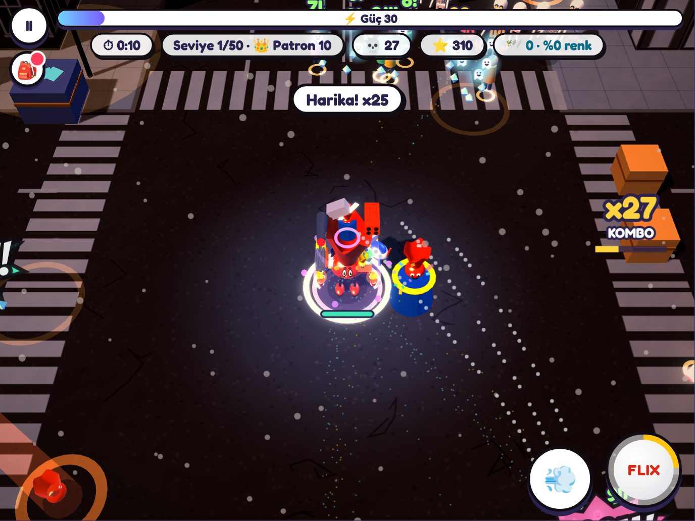
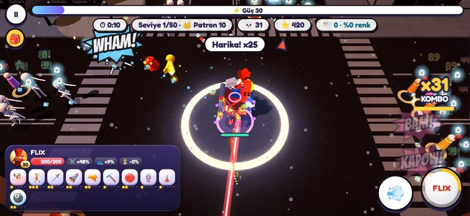
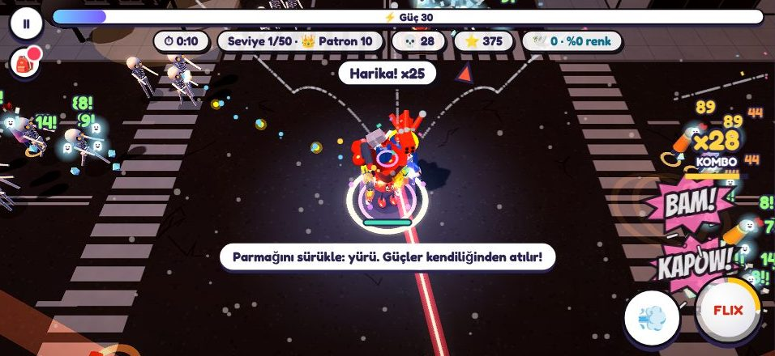

---

# ARKANA: Flix Fırlat ve Patron Hikayeleri (v24, 2026-10-13)

Önceki sürüm (v23) `arkana-v23.html`, kaynak `arkana9.html`.

- Hikaye: her patrondan önce bir tanıtım sayfası (İskelet Kral, Kemik Ejderha, Mezar Devi, Kıyamet Lordu, VORTEKS), patron yenilince bölüm sayfaları. 10 ve 20'den sonraki bölümler 2 sayfaya çıktı (kurtulan çocuklar Flix'lerini FLIX'e verir, park yeniden dolar). Menüdeki "Hikaye" tüm sayfaları sırayla oynatır.
- Elden Flix fırlatma: her kahraman, her modda, kolunu savurup elinden renkli Flix fırlatır (🤾 Flix Atışı, kartlarla 5. seviyeye kadar güçlenir). Zıplayan Flix de artık elden atılıyor, kahraman attığı yöne döner.
- 5 yeni silah: 🔴 Lazer Işını (elden, delip geçer), 🧨 Flix Bombası (elden kalabalığa, 5. seviyede üçe bölünür), 🪢 Flix Kırbacı (önündeki sırayı şaklatır), 🔱 Kristal Mızrak (sırayı deler), 🗼 Flix Kulesi (yere kurulur, Flix atar).
- Mağaza: sekmeler iki satıra sığıyor, 🗺️ Haritalar ikinci sırada (önceden ekranın dışında kalıyordu). Kozmetik ve oynanış haritaları ayrı başlıkta. 3 yeni kozmetik harita: 🍭 Şeker Şehir, 🌇 Retro Dalga, 🌅 Altın Saat.
- iPad: oyun telefon boyutunda kurulup büyütülüyor, düğmeler ve yazılar artık küçük kalmıyor. 2K modu en fazla ~2,4 milyon piksel çiziyor (büyük iPad ekranı telefon kadar yük). iPhone SE'den 16 Pro Max'e ve iPad mini'den iPad Pro 13"e, yatay ve dik ekranda test edildi, hata yok.
- Denge: VORTEKS'in canı 26.000, Cehennem dalgaları biraz daha sert (yeni silahlar oyunu kolaylaştırmıştı).

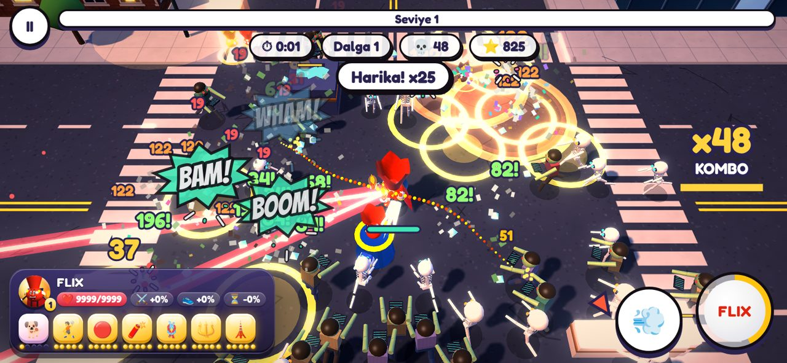
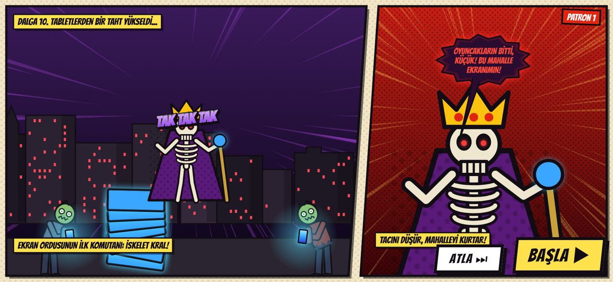
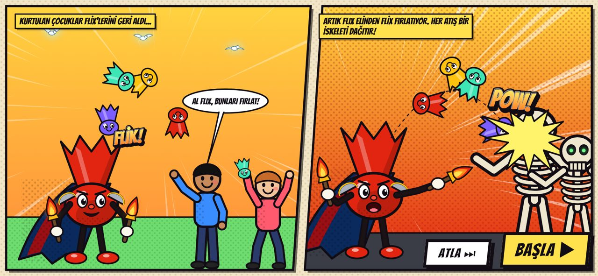
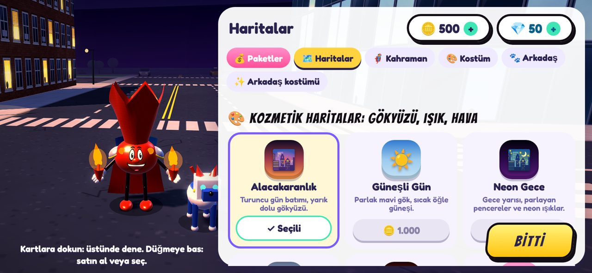
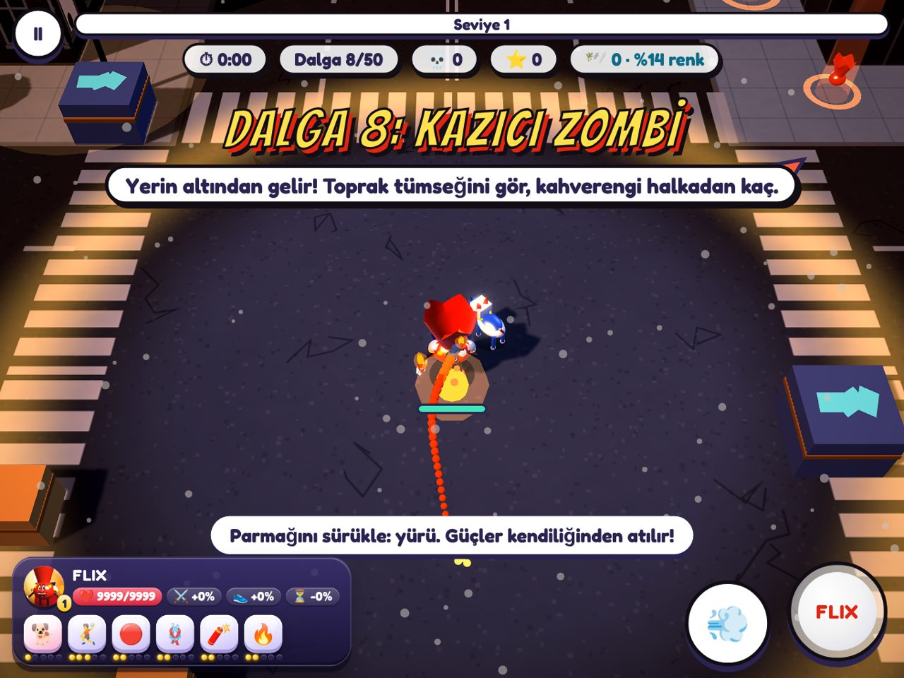

---

# ARKANA: Cehennem ve VORTEKS (v23, 2026-10-13)

Önceki sürüm (v22) `arkana-v22.html`, kaynak `arkana8.html`.

- Hikaye: giriş çizgi romanı her hikaye oyununda baştan gösterilir (önceden bir kez görünce atlanıyordu). 10, 20, 30, 40 ve 50. dalgaların sonunda patron ve ardından çizgi roman bölümü. 30'da geçmişe dönüş: şehrin eski kahramanı VORTEKS'i Kıyamet Lordu dev ekranla ele geçirmiş. 40'ta Kıyamet Lordu yıkılır ve VORTEKS ortaya çıkar. 50. dalganın son patronu VORTEKS: kara zırh, kırmızı vizör, tablet kalkanı; 3 faz (yelpaze ateş, hücum, sıçrama, kalkan, takviye düşmanlar). Yenilince kurtulur: "FLIX... Gözlerimi açtın. Teşekkürler!"
- Mağaza: yeni "💰 Paketler" sekmesi ilk sırada. Altın + elmas paketleri 0,99 $'dan başlar (Mini, Başlangıç, Kahraman, Macera, Efsane, Godlike), ayrıca 2,99 $ "Reklamsız + VIP" (oyunda şu an reklam yok; VIP günlük hediyeyi 2 katına çıkarır). Menüdeki altın ve elmas kutularına basınca paketler açılır.
- 3 yeni harita, oynanışı değiştirir: 🌋 Lav Vadisi (yerden lav fışkırır, düşmanları da yakar), 🧊 Buz Çağı (kaygan zemin, düşmanlar yavaş, düşen buz sarkıtları dondurur), 🏚️ Deprem Şehri (ara ara deprem, düşen taşlar, çok sayıda çatlak bina).
- Kırılabilir binalar: altında sarı-siyah şerit ve duvarında çatlak olan binalar ateş, patlama, araba patlaması, atılma (💨) ve FLIX gücüyle yıkılır; çökünce altındaki sokaktaki düşmanları ezer, kristal, hazine ve can düşürür.
- 😈 Cehennem modu: lav denizinin ortasında yuvarlak bazalt arena, 4 mangallı sütun. Gökten ateş topları yağar, ara ara lav kenardan taşar (ortaya koş), 5 dalgada bir patron, daha güçlü düşmanlar, 3 güç kartıyla başlar, ödül 1,6 kat. Akıllı bot 8 ile 28. dalga arasında düşüyor.
- Ayarlar (⚙️, menüde ve molada): Analog, Dokunmatik (dokunduğun yere yürür, basılı tutarsan takip eder) veya Yön tuşları (sol altta 8 yönlü tuş takımı). Ses ve grafik de burada.
- Güneşli Gün haritasındaki parlama düzeldi (her haritanın kendi parlama ayarı var).
- Kasma düzeltmeleri: çözünürlük ayarı artık bütün malzemeleri yeniden derlemiyor ve sık sık ileri geri değişmiyor; şehir blokları kare başına bir tane kuruluyor; patron ve yardımcı kahramanların çizimi menüdeyken hazırlanıyor (ilk patron oyunu dondurmuyordu); gölgeler artık kahramanı her yerde takip ediyor.

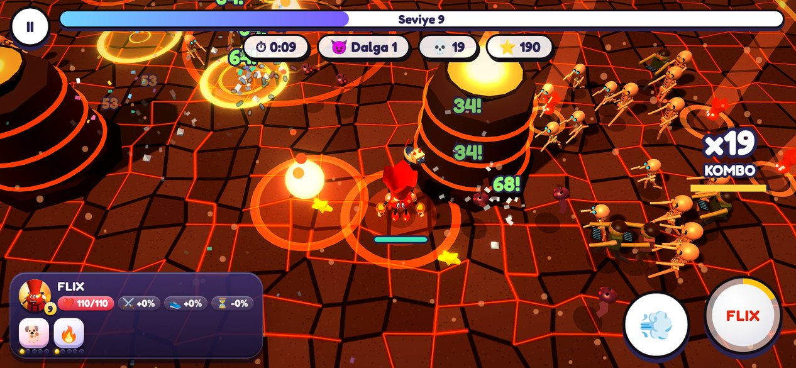
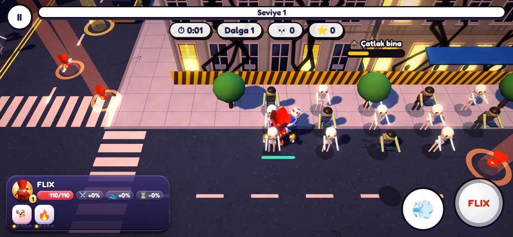

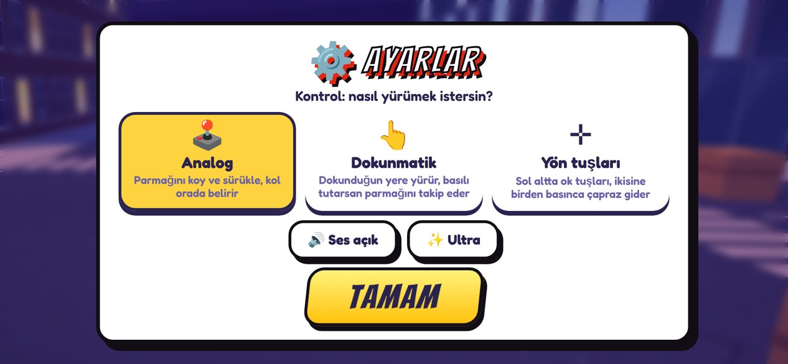
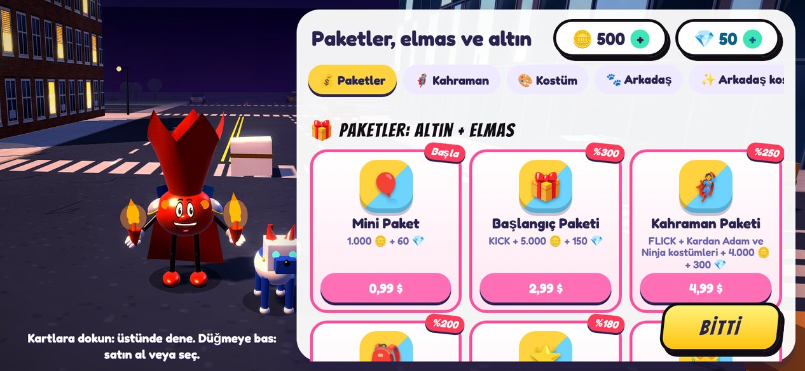

---

# ARKANA: FLIX Takımı (v22, 2026-10-13)

Hikaye 50 bölüm oldu, kahramanlar sadece FLIX karakterleri. Önceki sürüm (v21) `arkana-v21.html`, kaynak `arkana7.html`.

- Hikaye modu 50 dalga: her 10 dalgada patron ve çizgi roman bölümü, 50. dalgada Kıyamet Lordu: Son Form ile final savaşı, sonunda çocukların yeniden Flix oynadığı mutlu final (FLIX, KICK ve FLICK birlikte sevinir).
- Zorluk her 10 dalgada bir basamak artar (hikaye ve sonsuz). Akıllı bot hikayeyi az canla bitiriyor, daire çizen bot 6-40. dalgalar arasında düşüyor.
- Kahramanlar: FLIX, KICK (sarı damla başlı, kırmızı pelerinli, hızlı) ve FLICK (beyaz yuvarlak kafalı, neşeli, dayanıklı). VORTEKS, NOVA, TİTAN ve GÖLGE kalktı; eski kayıtta onları alanlara KICK/FLICK verilir.
- Her kahramana 9 kostüm, nadirlik sırası Common, Rare, Epic, Legendary, Mythic, Godlike. Mythic 1.200 💎, Godlike 6.500 💎.
- Ekonomi: altın + elmas. Elmas patronlardan, her 10 dalgadan, hikaye finalinden ve günlük hediyeden gelir; mağazada gerçek parayla elmas ve altın paketleri (web'de demo, gerçek ödeme App Store sürümünde).
- Hikaye modunda nadiren açık olan diğer kahramanlardan biri gökten iner, 13 saniye yardım eder ve gider.
- Sol altta yeni 3D karakter kartı: yüz portresi, can, hasar, hız, bekleme ve aktif boost.
- Haritaya dağılan görünüm değiştiren 5 boost: Dev FLIX (9 sn), Uçuş (7 sn), Roket Ayakkabı, Altın Yıldız (5 sn dokunulmazlık), Mini FLIX. Kısa süreli, dengeyi bozmayacak güçte.
- Daha pürüzsüz karakter modelleri, oyuncak plastiği ışıltısı, kenar ışığı; şehir duvarlarında yüksek çözünürlüklü tuğla, pencere, perde, klima ve kir izleri.
- Mağaza ve menüde 3D kahraman portreleri, menüde kahraman seçici.

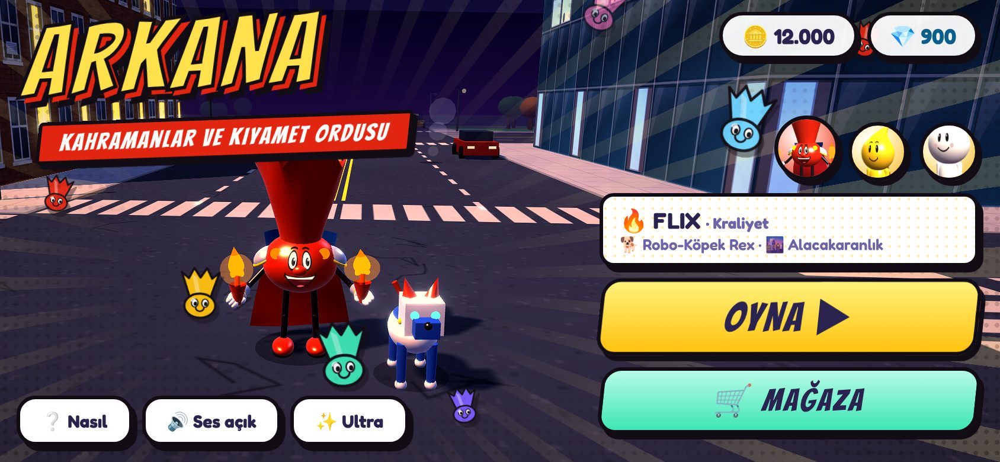
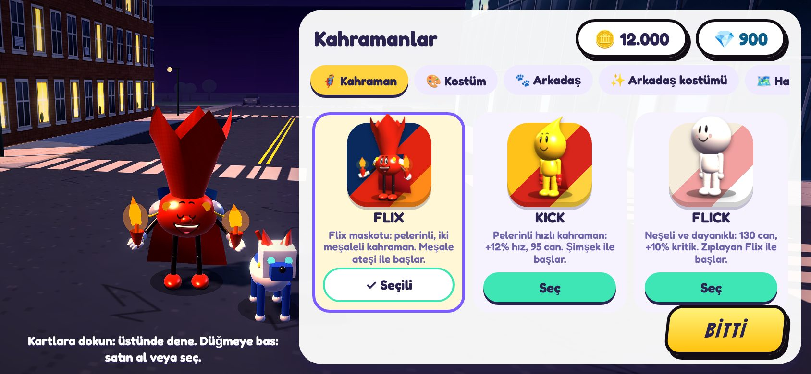
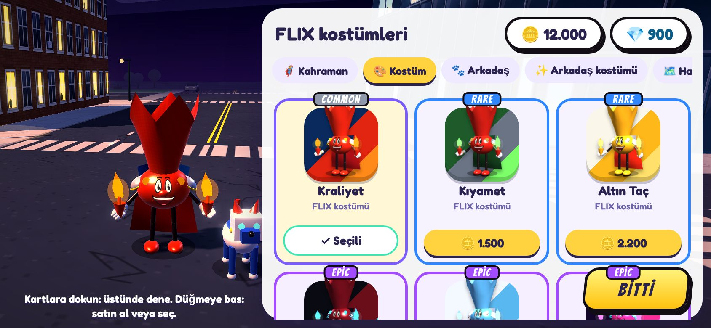
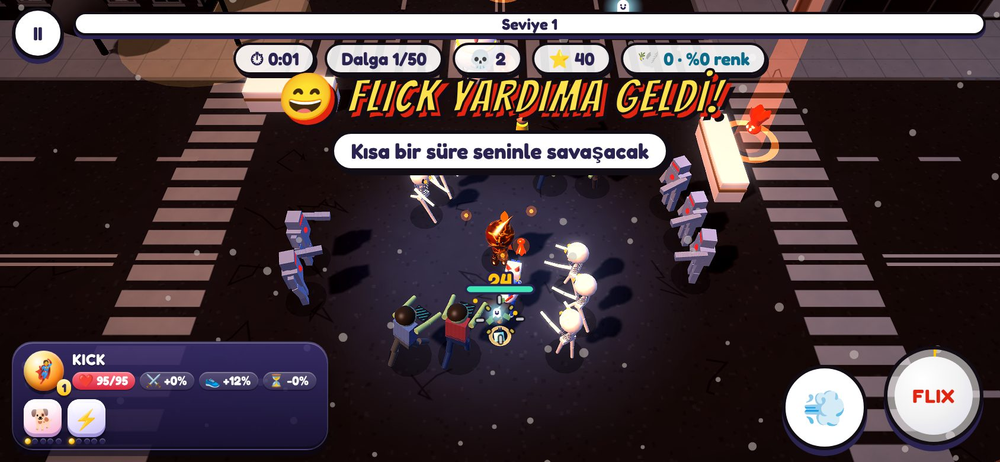

---

# ARKANA: FLIX ve Renksiz Şehir (v21, 2026-10-13)

Hikaye modu artık çizgi roman. Önceki sürüm (v20) `arkana-v20.html`.

- Çizgi roman hikaye (Marvel tarzı: kalın mürekkep, nokta tramı, sarı anlatı kutuları, konuşma balonları, KRA-KOOM yazıları): insanlar Flix yerine tabletlerle oynamaya başlar, şehir rengini kaybeder, dev ekrandan Kıyamet Lordu çıkar ve ekrana kapılanlar zombi, iskelet ve robota dönüşür. FLIX iner: "Flix ateşi sönmez!" Girişte 4 sayfa, 5., 10. ve 15. patrondan sonra birer bölüm sayfası, sonda final. Mod ekranında "📖 Hikayeyi oku".
- Kıyamet şehri: hikaye modu gri ve kül yağan bir şehirde başlar. Her yenilen düşmanın ruhu (beyaz güvercin) serbest kalır, bazıları elinde Flix tutan insana döner. Her dalgada şehrin bir bölgesi altın bir halkayla rengine kavuşur, patronlar büyük bölgeleri açar, sonunda bütün şehir renklenir. Gökte dev kötü tablet.
- Seviye takılması düzeldi: kristal sınırı dolunca XP kayboluyordu. Artık 25. seviyeye kadar yeni güçler, sonra sınırsız ilerleme (hasar, can, hız, güç sıklığı kartları).
- Oyunda hiç top yok: bütün toplar Flix figürü oldu (Zıplayan Flix, FLIX gücü, Vorteks yörüngesi).
- Kaçış yolları: arabaya yaslan veya atıl, fitili yanar ve patlar (zincirleme patlama, yol açar); kırılabilir kasa, bariyer ve tablet yığınları; 💨 Atılma düğmesi (dokunulmaz, engelleri kırar); kontrolden çıkmış taksi uyarıyla geçer, düşmanları biçer.
- Yeni güçler: Meşale Savuruşu, Flix Mayını, Kasırga, Pelerin Zırhı (toplam 20 güç).
- Yeni yol arkadaşları: Buz Pengueni Pıt, Tank Kaplumbağa Taş, Fener Ruhu Lumi. Yeni kostümler: FLIX Buzul, Neon, Süper Yıldız; her kahramana ve her arkadaşa birer yeni kostüm.
- Daha keskin görüntü (keskinleştirme, daha dar parlama), her öldürmede mürekkep yıldızı, büyük düşmanlarda POW!, BAM!, ZAP! yazıları.
- Çizgi roman arayüz: Bangers yazı tipi, siyah çerçeveli düğmeler, renkli mod panelleri. Ana ekranda zıplayıp dönen FLIX (dokununca hareket yapar), uçuşan Flix figürleri, hareket çizgileri.
- Test: akıllı bot hikayeyi 20. dalgada kazanıyor (bütün çizgi roman sayfaları akışta açılıyor), daire çizen bot 15. dalgada düşüyor. Hata yok.

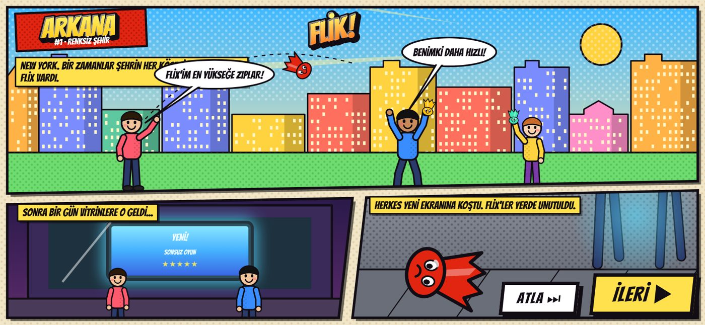
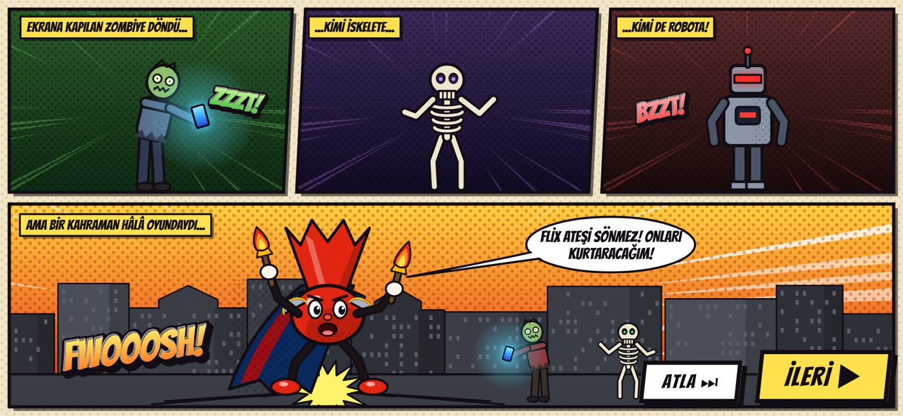
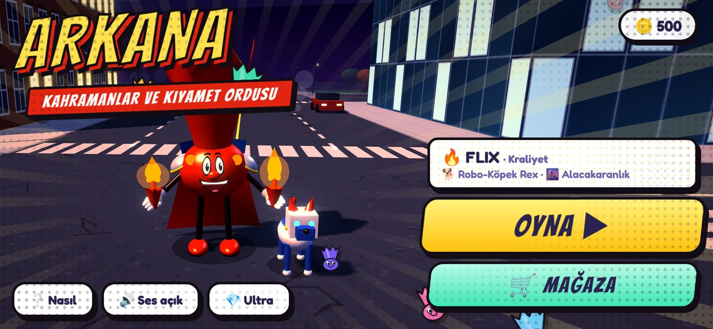
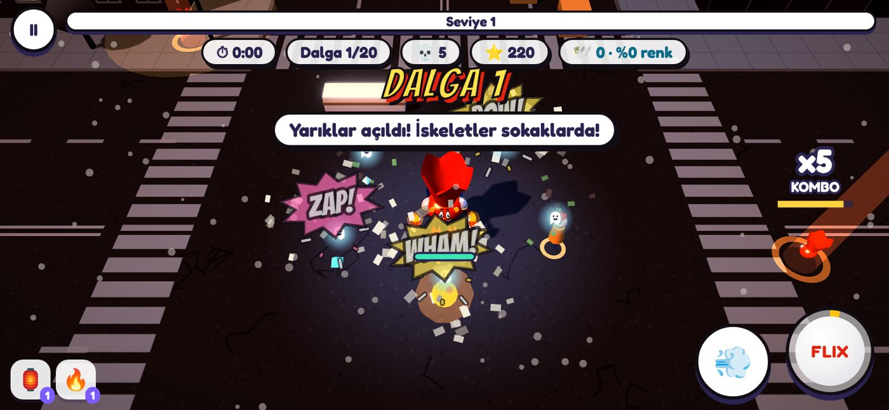
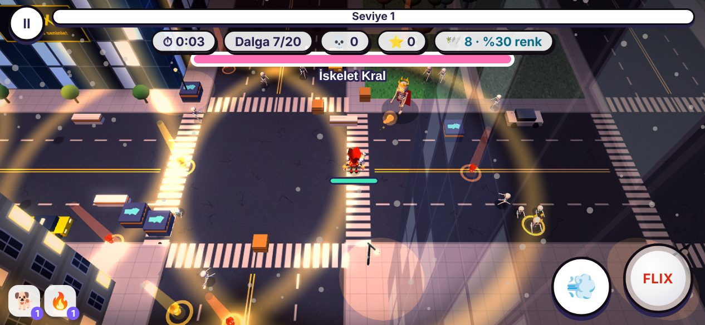

---

# ARKANA: FLIX ve Kıyamet Ordusu (v20, 2026-10-13)

Ana kahraman artık Flix maskotu. Önceki sürüm (v19) `arkana-v19.html`.

- FLIX: lale başlı, zikzak taçlı, iki meşaleli, Doctor Doom tarzı pelerinli kahraman. Yüz ifadeleri (gülme, göz kırpma, bağırma, acı), kafa esneme, sallanan taç, dalgalanan pelerin, titreşen alevler.
- Mağaza: 5 kahraman (FLIX, Vorteks, Nova, Titan, Gölge), her birine kostümler; 5 yol arkadaşı (Rex, Drone, Kedi, Kartal, Ejderha Kıvılcım) ve kostümleri; 5 harita (Alacakaranlık, Gündüz, Neon, Kar, Fırtına). Altın koşulardan ve günlük hediyeden gelir. Altın paketleri web'de demo, gerçek ödeme App Store sürümünde.
- 4 mod: Hikaye, Sonsuz, Patron Koşusu, Flix Avı (4 dakikada 40 Flix).
- Şehre dağılmış toplanabilir Flix figürleri (puan, altın, FLIX gücü), altın Flix, skor ve kombo çarpanı, yarık kapatma görevi.
- Yeni düşmanlar: uçan Yarasa sürüleri, yerin altından çıkan Kazıcı Zombi, altın taçlı Elit düşmanlar (5 kat can, altın Flix düşürür).
- Zorluk: ilk 10 seviye kahraman çok güçlü, sonra kademeli normalleşir.
- Vuruş hissi: beyaz parlama, ezilip zıplama, kıvılcımlar, kritikte sarsıntı, büyük öldürmede anlık donma, titreşim.
- Görüntü: "💎 Ultra" ekranın tam çözünürlüğü (4K'ya kadar), 60 fps hedefi; telefon zorlanırsa çözünürlük düşer, rahatlayınca geri çıkar.
- App Store paketi (Capacitor) proje dosyalarında: `flix/lootback/app/`.
- Test: akıllı bot 20 dalgayı bitiriyor, daire çizen bot 12. dalgada düşüyor.

---

# ARKANA: Vorteks ve Kıyamet Ordusu (v19, 2026-10-12)

Evrenler arası yarıklar açıldı; iskeletler, zombiler ve robotlar New York'a dökülüyor. Önceki sürüm (v18) `arkana-v18.html`.

- Özgün kahraman VORTEKS: grafit zırh plakaları, kırmızı-altın detaylar, parlayan vizör ve göğüs çekirdeği, sırt iticileri, Flix çizgili uçuşan atkı, etrafında dönen Flix topu. Atışta tekme animasyonu.
- 14 düşman türü, 3 aile. İskeletler (8 tür, darbe ile zayıf), Zombiler: Zombi (yakalarsa yavaşlatır), Sürünen Zombi, Asit Tükürgen (yerde yeşil asit gölü) — ateşe zayıf. Robotlar: Avcı Robot (nişan çizgisi + 3 lazer, zırhlı), Avcı Drone (binaların üstünden uçar), Savaş Makinesi (füze yağmuru) — şimşeğe zayıf, şimşek zırhı deler. Zayıf noktaya vuruş yeşil "!" ile gösterilir.
- Yeni final patronu Kıyamet Lordu (pelerinli, bıçak taçlı zırhlı tiran): sıçrayıp ezer, lazer yelpazesi, füze yağmuru, asker çağırır.
- Daha geniş şehir: geniş caddeler, 4 bölge (Midtown, Brownstone, Yıkık bölge, Park), yanan arabalar, kraterler, sokaklarda yarık portalları, gökte dev yarık.
- 2K sinematik görüntü: gerçek zamanlı gölgeler, bloom ışıması, renk düzenleme, vinyet, piksel oranı 3'e kadar. Menüde/duraklatmada "🎬 2K / ⚡ Hızlı" düğmesi; telefon zorlanırsa çözünürlük kendiliğinden düşer.
- Test: akıllı bot 20 dalgayı bitiriyor, daire çizen bot 15. dalgaya kadar dayanıyor.

---

# ARKANA: Kaptan Flix ve İskelet Ordusu (v18, 2026-10-12)

Kaan'ın isteğiyle oyun New York sokaklarına taşındı. Önceki çayır sürümü (v17) `arkana-v17.html` olarak duruyor.

- Sonsuz New York: sokak ızgarası, kahverengi taş binalar, ofisler, cam kuleler, su kuleleri, sarı taksiler, sokak lambaları, parklar, fıskiyeli meydanlar, Flix reklam panoları. Binalar ve park halindeki arabalar katı; kahramanı kapatan binalar saydamlaşır.
- Kahraman: Kaptan Flix (insan oranlarında, pelerinli, Flix renkli kostüm, göğsünde F amblemi). Yürüme/koşma/atış animasyonları.
- Yol arkadaşı (menüde seçilir, kartlarla 5 seviye): Robo-Köpek Rex (atılıp ısırır), Flix Drone (lazer), Şifacı Mia (can doldurur, kristal toplar). Toplam 17 güç.
- 8 iskelet türü, her biri farklı karşılık ister: İskelet, Koşucu, Hayalet (duvardan geçer, arada görünmez), Bombacı (kırmızı halka, patlaması iskeletleri de vurur), Okçu (kırmızı nişan çizgisi, oklar binalara takılır), Dev İskelet (hücum şeridi; duvara çarparsa sersemler), Kalkanlı (önden gelen mermileri bloklar), Nekromant (iskelet çağırır, iyileştirir). Yeni tür geldiği dalgada ipucu çıkar.
- İskeletler sokak ızgarasında yol bularak gelir. Patronlar: İskelet Kral, Kemik Ejderha, Mezar Devi, Lich Kral.
- Daha keskin görüntü: piksel oranı 2'ye kadar, anizotropik dokular.
- Test: akıllı bot 20 dalgayı bitiriyor, daire çizen bot 12. dalgada düşüyor.

---

# ARKANA: Büyücü Pako ve Somurtkanlar (Vampire Survivors tarzı)

v17 (2026-10-12): Kaan'ın isteğiyle Vampire Survivors tarzına geçildi. Rün çizmeli arena sürümü (v16) `arkana-v16.html` / GitHub'da `lootback/arkana-v16.html` olarak duruyor.

## Oynanış
- Sonsuz çiçekli çayır: ağaçlar, mantarlar, kristaller, ara ara beyaz Flix kaleleri. Harita oyuncuyla birlikte sonsuza uzanır.
- Ekranın herhangi bir yerinde parmağını sürükle = yürü (yüzen analog). Klavyede WASD. Saldırılar tamamen otomatik, dururken de vurur.
- Düşmanlar sevimli "Somurtkanlar"; yenilince konfetiye dönüşüp yıldız bırakır. Yıldız topla, seviye atla, 3 karttan birini seç.
- 16 güç: 10 büyü (Sihirli Ok, Flix Topu, Dönen Yıldızlar, Ateş Topu, Şimşek, Buz Dalgası, Bumerang Şapka, Gökkuşağı Halkası, Yıldız Yağmuru, Prizma Işını) ve 6 eşya (Mıknatıs Yüzük, Rüzgar Ayakkabısı, Büyü Kitabı, Kristal Kalp, Büyüteç, Şans Yoncası). Her biri 5 seviye; en fazla 6 büyü ve 6 eşya.
- 20 dalga, her biri 30 saniye. Her dalgada yeni düşman türü veya olay: hızlı bulutlar, yarasa sürüsü, zıpzıplar, baloncular, koca somurtkanlar, kalkanlılar, çember tuzağı.
- Patronlar: 5 Somurtkan Kral (zıplayıp ezer), 10 Huysuz Ejderha (baloncuk yelpazesi), 15 Taş Dev (gökten taş), 20 Gölge Kral. Patron yenilince hazine sandığı 3 güç verir. 20. dalgadan sonra sonsuz devam.
- FLIX düğmesi (sağ alt): düşman yendikçe dolar, dev Flix topu fırlatır.
- Dikey telefonda oyun kendini yan çevirir; ters görünürse menüdeki "⟲ Ters mi? Çevir".

## Test
- Akıllı bot 20 dalgayı bitiriyor; basit daire çizen bot 11. dalgada düşüyor. Ekranda 300'e kadar düşman.

---

# ARKANA v16: Rün çizmeli arena (eski sürüm)

v16 (2026-10-12): Kaan'ın isteğiyle oyun baştan değişti. Kargo mekaniği tamamen kalktı; artık mistik bir büyücüyle 3D arena savaş oyunu. Eski LOOTBACK (v15) `lootback-v15.html` / GitHub'da `lootback/v15.html` olarak duruyor.

## Oynanış
- Yıldızlı gökyüzünde yüzen rün arenası. Düşmanlar portallardan dalga dalga gelir.
- **Sol tarafta sürükle:** yürü (yüzen analog). Klavyede WASD / ok tuşları.
- **Sağ tarafa dokun:** en yakın düşmana bedava büyü oku (Space).
- **Sağda rün çiz** (çizerken zaman yavaşlar):
  - Çizgi = **Ateş oku**: çizilen yöne delip geçer. 20 mana (1).
  - Z / zikzak = **Şimşek**: düşmandan düşmana sıçrar, sersemletir. 30 mana (2).
  - Daire = **Nova**: etrafı patlatır, iter, zırh kırar, düşman mermilerini siler. 35 mana (3).
  - Sağ alttaki üç düğme de aynı büyüleri yapar.
- Mana zamanla ve düşmanlardan düşen mavi kristallerle dolar. 5 can; her dalga 1 can verir.
- Düşmanlar: İblis (koşar), Yarasa sürüsü (zikzak), Göz (uzaktan zehir topu atar), Taş Golem (zırhlı: önce nova ile zırhını kır).
- Dalga 5: **Taş Dev** (yere vurur, turuncu halkadan kaç). Dalga 10: **Gölge Ejderha** (havadan ateş yağdırır, yaratık çağırır; yere inince altın çekirdeği parlar, 2 kat hasar alır; yarı canda öfkelenir).
- Her dalga sonunda 3 güç kartından biri seçilir (13 güç: çoklu ok, üçlü ateş, büyük nova, zincir şimşek, mana pınarı, ejder kalbi, buz dokunuşu, ruh emici...).
- Kombo: art arda öldürmek puanı katlar. Ejderha yenilince "Sonsuz devam" ile dalgalar sürer.
- Dikey kalan telefonda oyun kendini yan çevirir; ters görünürse menüdeki "⟲ Ters mi? Çevir".

## Test
- Rün tanıma: titrek çizgi/eğri çizgi, Z/V/N/zikzak, tam/eksik/oval daire, dokunma: 260 denemenin hepsi doğru.
- Kusursuz kaçan test botu 10 dalgayı 2-5 canla bitiriyor (insan için daha zor).

---

# LOOTBACK (eski sürüm notları)
# LOOTBACK MVP

Dosya: `index.html` (tek dosya, internet gerekmez). Spesifikasyon: Kaan'ın gönderdiği LOOTBACK_Claude_MVP.md.

## Kontroller
- Klavye: A/D veya ←/→ yürü; Boşluk/W/↑ zıpla (basılı tut = daha yüksek); Esc mola; R tekrar dene (çantada: döndür). ` tuşu geliştirici çerçevelerini açar.
- Dokunmatik: sol/sağ tuşlar, büyük zıplama tuşu; çanta tuşu yük bırakma menüsünü açar.
- Çanta: eşyaya dokun, sonra çantada sol üst hücreye dokun ya da sürükle. "Döndür", "Çıkar", "Örnek yük".

## Challenge (v2, 12 Ekim 2026)
- Arkadan kovalayan ejderha: 1 sn sonra peşe düşer (hız B1 160, B2 165, B3 165). 800 birimden fazla geride kalırsa hızlanır. Yakalarsa bölüm biter. Ağır yük yavaşlattığı için yük seçimi ve yolda yük bırakma artık önemli. HUD'da 🐉 mesafe, yaklaşınca solda kırmızı ışık.
- Balçıklar: platformda gidip gelir; üstüne zıplayınca ezilir, yandan çarpınca bölüm biter.
- Yarasalar: sabit desenle uçar, dokunursan bölüm biter.
- İleriye bakan bot ejderha, balçık ve yarasalarla üç bölümü de bitirdi (spec yükleriyle; ejderha farkı en az 230 birim).

## Yük yerleşimi (v3, 12 Ekim 2026)
Kaan'ın isteğiyle spec'teki başlangıç sayılarından güçlü hale getirildi:
- Yük sağdaysa sağa 256, sola 190 hızla gidersin (sandık tek başına); havada yükün olduğu yana kayarsın.
- Sandık üstte: durma mesafesi 42 birim, zıplama 94; altta: 17 birim, zıplama 113. Üst yük inişte sendeletir.
- Karakter yükün olduğu yana eğilir, üst yükte sallanır, ağırlıkla çömelir, çanta büyür. Çanta ekranında canlı karakter önizlemesi var.
- Durunca kayma yok (ölçüldü: 0).

## Eğlence (v4, 12 Ekim 2026)
- Yüz ifadeleri: ezince güler, ejderha yaklaşınca terler ve korkar, sendeleyince başı döner, düşerken bağırır, iksir çatlayınca yüzünü buruşturur, ağır yükte dişlerini sıkar.
- Konuşma balonları (başlangıç, ezme, ejderha, iksir, yük bırakma, teslimat) ve ejderhanın "GRAAAA!" kükremesi; komik yenilgi başlıkları.
- Ezme kombosu: havada art arda ezdikçe +25, +50, +75... bonus. Zıplama tuşunu basılı tutarak ezersen süper sıçrama. Yarasalar da ezilebilir.
- Riskli yollarda altın paralar (+10). Bonus ayrı gösterilir, yıldızlar hâlâ teslim edilen ganimete göre.
- B1 ejderha hızı 160→150; B1 üst yol platformları alttan geçilebilir yapıldı (alt yoldan zıplayınca kafa çarpıp düşülüyordu).

## Görsel stil (v5, 12 Ekim 2026)
Spider-Verse esinli çizgi roman görünümü: neon CMYK paleti (camgöbeği, macenta, sarı), kalın siyah köşeli hatlar, halftone nokta gölgeler, cel gölgelendirme. Karakterler 12 fps pozlarla oynar (hareket akıcı, poz kesik). POW/SPLAT/THUD/BONK/BOING kelime patlamaları, hızda hız çizgileri, büyük darbelerde baskı kayması efekti. Menüler çizgi roman panelleri gibi.

## Görseller
X gönderisi (DeepTechTR) ve kenney.nl bu ortamdan açılamadı (proxy engeli). Tüm çizimler Canvas ile yapılmış geçici çizimler; `SPRITES[id]` eşlemesine gerçek sprite eklenince otomatik kullanılır.

## Kabul kontrolleri (12 Ekim 2026, headless Chromium)
Doğrulandı:
- Açılışta hata yok; başlık → bölüm → çanta → koşu → sonuç akışı.
- Çakışan / dışarı taşan yerleştirme reddediliyor, eski yer korunuyor.
- Örnek yük: 13 kg, 1100 altın, iksir korunuyor, kılıç dik.
- Sandık üstte: ivme 816 / fren 701; altta: 1026 / 862. Sol/sağ denge B = −0,5 / +0,5.
- 54 birimlik tünel dik kılıcı durduruyor (x≈1135'te takılıyor), yatay kılıç geçiyor.
- İksir: 220 birim düşüşte korumasız −38,5, korumalı −19,2; düz zıplamalarda hasar yok.
- Yumurta ilk darbesi 4,50 sn'de; aynı adımda elle zıplama ile üst üste binmiyor.
- Kılıç bırakılınca çarpışma kutusu 60→44, ayak konumu aynı.
- Bot ile bitirilen rotalar: B1 sandık, kristal, ikisi (üst yol); B2 yatay kılıç tünel, dik kılıç üst yol; B3 örnek yük (üst yol) ve kristalsiz yatay kılıçlı yük.
- Dokunmatik: sağ + zıplama aynı anda çalışıyor; pointercancel sonrası tuş takılı kalmıyor (Chromium dokunmatik emülasyonu).
- Telefon yatay 844×390 düzeni, dikey ekranda "yan çevir" uyarısı.

Doğrulanmadı:
- Gerçek telefonda oynanış ve FPS.
- Farklı ekran yenileme hızları (sabit 1/120 adım kullanılıyor, ölçülmedi).
- 20 tekrar sonrası döngü sayısı (tek rAF döngüsü, dinleyiciler bir kez ekleniyor; sayılmadı).
- Bölüm süreleri: bot 13–20 sn'de bitiriyor, insan için hedef 60–90 sn; par süreleri cömert kalabilir.

## v6: karakter ve eğlence (2026-10-12)
- Hamal yeniden tasarlandı: büyük chibi kafa, alında gözlük (camgöbeği camlar), dikenli saç, eldivenler, fermuarlı iki renkli ceket, rüzgârda dalgalanan atkı (fizikli).
- Boşta durunca ayağıyla ritim tutar ve sıkılıp laf atar.
- Bitişte zafer dansı ve konfeti.
- Komik kaybetme animasyonları: ejderha yakalarsa kömür olup öksürür; diken/yaratıkta fırlayıp döner; çukura çığlıkla düşer. Kaybetme ekranı 1,1 sn sonra gelir.
- Eşya bırakınca ejderha durup onu yer ("NOM NOM"); yeni kaçış taktiği.
- Doğrulandı: bot regresyonu 8 yükte de 3 bölümü bitirdi, sayfa hatası yok.

## v7: bölüm 4-6 (2026-10-12)
- Yeni mekanikler: yay (BOING, yük ağırlaştıkça daha az fırlatır, zıplamayı basılı tutunca biraz daha yükseğe) ve ateş ızgarası (sırayla yanar, kıvılcım uyarısı verir, kristalle üstünden atlanır; değince hamal kömür olur).
- Bölüm 4 "Zıp zıp yaylar": yayla duvar ve uçurum geçişi, dikenin üstünden yay.
- Bölüm 5 "Ateş çukuru": ateş ızgaraları, köprü tahtaları, alev dalgası.
- Bölüm 6 "Ejderhanın ini": yay, alçak tünel, ateş dalgası ve 5 eşyanın hepsi.
- Doğrulandı: bot her yeni bölümü 2 farklı yükle bitirdi (ağır, kristalsiz yükle 6. bölüm en zoru), sayfa hatası yok.

## v8: hikaye ve oyun mantığı (2026-10-12)
**Hikaye.** Neon Kasaba'da festivalden bir gece önce ejderha Kor parlayan her şeyi çalıp inine taşır. Acemi kurye Pako (LOOTBACK Kargo) ilk büyük işini alır: hazineleri geri getirmek. Batırırsa kovulacak. İşi veren Muhtar Nine. Sonda yumurta Kor'un yavrusu çıkar; Kor hazineleri yuva için topluyormuş, barışılır ve Kor kargonun ejderhası olur.
Çizgi roman panelleri: girişte 6 panel, her bölüm öncesi 3 panel, 6. bölümden sonra 5 panellik final. İlk seferde otomatik açılır, sonra "Hikaye" düğmesiyle tekrar izlenir; "Atla" ile geçilir.

**Kurallar.**
1. Her bölümde bir sipariş var. ŞART eşya (B1 sandık, B2 kılıç, B3 yumurta, B4 kristal, B5 iksir, B6 taç sandığı) çantada olmadan yola çıkılmaz. Bırakılır ya da iksir kırılırsa teslimat sayılmaz: para yok, bölüm açılmaz.
2. Diğer eşyalar ekstra ücret getirir ama ağırlık yavaşlatır, Kor'a yakalanma riskini artırır.
3. Çantadaki yer hamalın dengesini değiştirir: hız, fren, zıplama, eğilme. İksir korunması ve kılıcın tünele sığması da yerleşime bağlı.
4. Söz verilen süre (HUD'da "geçen / söz" olarak görünür). Geç kalırsan ücretin yarısı.
5. Kor yakalarsa ganimet geri gider, bölüm baştan.
6. Yıldız: 1 = sipariş teslim, 2 = zamanında, 3 = zamanında ve eşya değerinin en az %80'i. Her bölümün en iyi ücreti "kargo kasası"na yazılır (ana ekranda).

## v9: kurye rotası (2026-10-12)
Kaan "Kurye rotası" fikrini seçti (bkz. brainstorm.md). v8'deki ŞART eşya ve geç kalma cezası kaldırıldı; her bölüm öncesi çıkan hikaye panelleri otomatik açılmıyor (giriş paneli ana ekrandaki "Hikaye" düğmesinde, final 6. bölümden sonra).
- Her eşyanın bir sahibi var: sandık → Muhtar Nine, kılıç → Demirci Dede, kristal → Fenerci Lale, iksir → Küçük Elif, yumurta → Aşçı Remzi. Evleri yol boyunca; penceredeki kişi istediği eşyayı balonda gösteriyor.
- Evin önünden geçerken eşya çantanın üstündeyse (üstünde başka eşya yoksa) kendiliğinden fırlatılır. Altta kalan eşya için evin önünde durmak gerekir (1,1 sn karıştırma), bu sırada Kor yaklaşır. Teslim edilen eşya çantadan çıkar, Pako hafifler.
- Teslim edilen ev yanar, sahibi sevinç repliği söyler. Önünden geçilen ev karanlık kalır, sahibi kızar. Kırık iksir teslim edilemez.
- Çanta ekranı: teslimat rotası listesi, eşyalarda "N. durak", çantada ⬆ AT / ⛏ KAZ rozetleri.
- Sonuç: yanan ev sayısı. 3 yıldız = hepsi, 2 = en az yarısı, 1 = en az biri; hiç ev yanmazsa teslimat başarısız. Ana ekranda "Neon Kasaba ışıkları X / 24 ev".
- Evler yaratık/ateş alanlarının dışına yerleştirildi; L5'teki balçıklar kaldırıldı, alev dalgası biraz yavaşladı.
- Doğrulandı: bot 6 bölümü 13 yükle bitirdi, karıştırma ve fırlatma birim testleri geçti, sayfa hatası yok.

## v10 / 1.0 mobil sürüm (2026-10-12)
- Yandan görünüm 3D: three.js toon gölgeleme ve kalın çizgi. Kuryeler, Kor, balçık, yarasa, evler, yaylar ve alevler 3D model. three.js yüklenemezse oyun eski 2D çizimle çalışır.
- Açılış ekranı (Flix Games), ana menü (3D Pako + uçan Kor), alt menü: Kuryeler, Yükselt, Mağaza, Hikaye, Ayarlar.
- Modlar: Hikaye (6 bölüm), Sonsuz kaçış (rastgele yol, her 5 evde kargo durağı, Kor hızlanır), Günlük teslimat (aynı gün herkese aynı yol, 8 ev = 30 elmas).
- 6 kurye: Pako (bedava), Fenerci Lale, Aşçı Remzi, Demirci Dede (altın), Gece Kuryesi, Ejderha Pako (elmas). Her birinin yeteneği var.
- 4 yükseltme, 3 seviye: Hızlı eller, Yastıklı çanta, Yaylı botlar, Ejderha yemi.
- Para birimleri: altın (oynayarak), elmas (premium). Yeniden canlanma: reklam ya da 20 elmas. Bölüm sonu altını reklamla 2 katı. Her 3 bölümde bir geçiş reklamı.
- Mağaza web'de test modunda: ödeme alınmaz. Gerçek satın alma ve reklam için `app/` klasörüne bak.
- Müzik (prosedürel), titreşim, ayarlar, ilerleme sıfırlama, satın alım geri yükleme.
- Uygulama paketi: `app/` (Capacitor, native-bridge.js, ikon, mağaza metinleri TR/EN, gizlilik politikası taslağı, ürün listesi).

## v11 (2026-10-12): analog kontrol, çanta gücü, yeni modlar
- Kontrol: telefonda solda analog çubuk (az itersen yürür, tam itersen koşar), sağda zıplama ve ⚡ güç tuşu. Ayarlardan eski sol/sağ tuşlarına dönülebilir. Klavye: E veya Shift = güç.
- Çanta gücü: çantanın en üstündeki eşya güç verir. Kılıç = Kesik (atılıp keser, ateş topunu böler), Kristal = çift zıplama, İksir = Turbo (iksirin %10'u gider), Yumurta = süper zıplama, Sandık = yer sarsıntısı. Eşya teslim edilince güç alttakine geçer.
- Coşku: ezme, altın ve teslimatlar barı doldurur; dolunca 6 sn hızlı, dokunduğun düşman ezilir, altın 2 kat, Kor yavaşlar.
- Sonsuz kaçışta 25. saniyeden sonra Kor ateş topu tükürür (kırmızı halka iniş yeri).
- Yeni modlar: Teslimat yarışı (75 sn, her teslimat +3 sn, Kor yok), Hazine avı (Kor önde kaçar, düşürdüğü hazineleri kaparsın, çanta ağırlaşır, KASA'da boşaltırsın, Kor çok uzaklaşırsa biter), Kor düellosu (boss: ateş topu, yere inip alev püskürtme, sersemleyince kafasına zıpla, 4 can; ilk zafer +50 elmas).

## v12 (2026-10-12): Hikayenin 2. kısmı, Ana Kor
- 6. bölüm bitince final, ardından 2. kısmın girişi oynar: Kor'un annesi Ana Kor, torununun "omlet yapılacağını" duyup fenerleri dağa taşır.
- Yeni bölümler: 7 Dağ yolu (kayan platformlar, asansör), 8 Kasa yığını (kasa duvarları: Kesik, Yer sarsıntısı ya da coşku ile kırılır, hafif çantayla üstünden atlanır), 9 Ana Kor'un yuvası (her şey bir arada, Ana Kor ateş tükürür), 10 Ana Kor final düellosu. Kazanınca 2. kısmın finali oynar.
- 2. kısımda kovalayan ejderha mor (Ana Kor). Düelloda kamera tüm arenayı gösterecek kadar uzaklaşır.
- Test: 7-9 farklı çanta dizilimleriyle botla bitirildi, 1-6 hâlâ geçiyor, düello botla kazanıldı.

## v13: dönmeyen ekranda yatay oyun
- Telefon dikey kalırsa (ör. claude.ai uygulaması ekranı döndürmüyorsa) oyun artık "telefonu çevir" ekranında takılmıyor: bütün oyun 90° döndürülüp yatay çiziliyor. Telefonu yana çevirip oynarsın.
- Yön, telefonun eğiminden otomatik seçilir (iPhone'da ilk dokunuşta hareket izni sorulabilir). Ters görünürse ana menüde üstteki "⟲ Ters mi? Çevir" düğmesi yönü değiştirir ve hatırlar.
- Dokunma, analog çubuk ve çanta sürükleme döndürülmüş ekranda test edildi.

## v14: FIRLAT! (yeni ana mod)
- Menünün en üstünde. Pako kendi koşar; oyuncu sadece iki şey yapar:
  - **Sola dokun:** zıpla (basılı tut, daha yüksek). Önüne çıkan basamağa Pako kendi tırmanır.
  - **Sağda parmağını sürükle, bırak:** paket o yöne uçar. Nişan alırken zaman yavaşlar, uçuş çizgisi görünür.
- Karanlık evlerin penceresinde hedef var. Hedefe isabet = TAM İSABET (100 × kombo, en çok x10), eve değerse 50. Iska kombo'yu bitirir. Her 3 tam isabette +1 paket.
- Çantada 5 paket var; kargo durağı (her 5 evde bir) çantayı doldurur.
- Kor arkadan gittikçe hızlanır. Geriye paket fırlatırsan yakalayıp yer: durur ve geri düşer. Balçık ve yarasalar da paketle vurulur.
- Bu modda ateş topu yok, ateş ızgarası seyrek. Pako zamanla hızlanır.
- Menüden "Günlük teslimat" ve "Hazine avı" kaldırıldı (kod duruyor).

## v15: zorluk + funky görünüm
- FIRLAT! artık zor: 3 can (❤). Karanlık bırakılan her ev "ŞİKAYET!" = 1 can. 3 şikayet = oyun biter. 5'li tam isabet kombosu 1 can geri verir.
- 4. evden sonra pencerelerin kepenkleri açılıp kapanıyor. Kapalı kepenge atılan paket "TAK!" diye seker. Kapıya atmak güvenli ama kombo büyütmez.
- Pako zamanla daha çok hızlanıyor, tuzaklar da mesafeyle sıklaşıyor. Çantada 5 paket var, kargo durağı her 4 evde bir.
- Görünüm baştan değişti: 70'ler funky tarzı. Gün batımı gökyüzü, dönen güneş ışınları, çizgili retro güneş, dalgalı gökkuşağı tepeler, pofuduk bulutlar, dama desenli zemin, şeker renkli dans eden evler, yuvarlak düğmeler, Shrikhand ve Baloo 2 yazı tipleri.
